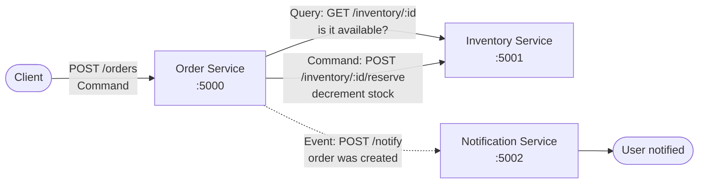

# cmpe-273 Module 4 Assignment: Architecture & Service Boundaries

A small distributed online store built with Python (Flask). Three services run as
**independent processes** and communicate over HTTP: the Order Service places orders,
the Inventory Service owns stock levels, and the Notification Service notifies users
when an order is created.

## 1. Architecture Design

### Diagram



### Responsibility of each component

| Service | Responsibility |
|---|---|
| **Order Service** (`order_service.py`, :5000) | Accepts order submissions, validates them, checks availability with Inventory, reserves stock, creates the order record, and emits the "order was created" event. Handles Inventory failures gracefully (503, stays alive). |
| **Inventory Service** (`inventory_service.py`, :5001) | Answers availability queries and executes stock reservations. It is the authority on what is in stock. |
| **Notification Service** (`notification_service.py`, :5002) | Purely event-driven. Receives "order was created" events and records/sends the user notification. It never initiates calls to the other services. |

### Data ownership

| Service | Owns | Does NOT own |
|---|---|---|
| Order Service | Order records (`order_id` → item, quantity, status). Only it creates or mutates orders. | Stock levels — it may only *ask* Inventory about them. |
| Inventory Service | The inventory catalog (item → quantity on hand). Only it decrements stock, via its `/reserve` command. | Orders — it never sees or stores order records. |
| Notification Service | The notification log (which order notifications were sent). | Orders and stock — it only receives a copy of order facts inside events. |

### Why these service boundaries

The boundaries follow **data ownership and failure isolation**, not just code size:

1. **Order and Inventory change for different reasons and at different rates.** Pricing/order rules evolve with the business; stock counts change with every sale and restock. Splitting them lets each scale and deploy independently.
2. **Inventory is the single writer of stock.** If two services could decrement the same counter, overselling would be inevitable. One owner + a `reserve` command keeps the invariant ("never sell what you don't have") in one place.
3. **Notification is decoupled via an event.** Order creation must not fail just because the notification channel is down, so the Order Service notifies fire-and-forget and never blocks the 201 response on it. A slow or dead Notification Service cannot cascade into lost sales.
4. **Failure domains stay small.** As the failure test below proves, Inventory can die and the Order Service degrades to a clean 503 instead of crashing — possible only because the dependency is a network call behind a timeout, not shared memory or a shared database.

## 2. Command, Query, and Event

| Interaction | Classification | Why |
|---|---|---|
| Check whether an item is available (`GET /inventory/{id}`) | **Query** | Read-only: it returns state without changing anything. Safe to retry and cache. |
| Create an order (`POST /orders`, incl. `POST /inventory/{id}/reserve`) | **Command** | It intends to change state (a new order record, less stock). Not idempotent by default — retrying blindly could double-reserve, which is why the Order Service validates before reserving. |
| Order was created (`POST /notify`) | **Event** | A fact about something that already happened, published after the state change. The Notification Service reacts to it; the Order Service doesn't wait for a meaningful reply (fire-and-forget, 202 accepted). |

## 3. Implementation

Python + Flask, one file per service, each running as its own OS process on its own port.
In-memory data (no database required). `requests` is used for service-to-service calls
with a 3-second timeout so a dead dependency fails fast. The "order was created"
event is dispatched to the Notification Service on a daemon thread, so the
notification round-trip never delays the 201 response — genuinely fire-and-forget.

### Install & run

```bash
python3 -m venv .venv && source .venv/bin/activate
pip install -r requirements.txt

# terminal 1 — Inventory Service
python inventory_service.py        # http://127.0.0.1:5001
# terminal 2 — Order Service
python order_service.py            # http://127.0.0.1:5000
# terminal 3 — Notification Service
python notification_service.py     # http://127.0.0.1:5002
```

Ports can be overridden with the `PORT` env var; the Order Service locates its
dependencies via `INVENTORY_URL` and `NOTIFY_URL` (defaults shown above).

### Example: successful request

The screenshots below document example terminal sessions for the services.


Check availability (Query):


Create an order — Order Service queries Inventory, reserves stock (Command),
stores the order, then emits the event:


The Notification Service receives the "order was created" event:


Out-of-stock items are rejected without creating an order:


Raw curl transcript of the happy path:

```bash
~/manoj$ curl -s localhost:5001/inventory/widget
{"available":true,"item_id":"widget","quantity":10}

~/manoj$ curl -s -X POST localhost:5000/orders \
    -H 'Content-Type: application/json' \
    -d '{"item_id":"widget","quantity":2}'
{"item_id":"widget","order_id":1,"quantity":2,"status":"created"}   # HTTP 201

~/manoj$ curl -s localhost:5002/notifications
[{"message":"Order #1: 2 x widget confirmed. Thanks for shopping!","order_id":1}]
```

## 4. Failure Test

**Setup:** with all three services running, the Inventory Service process was killed
(`fuser -k 5001/tcp`), then an order was submitted.

**Result:**


```bash
~/manoj$ fuser -k 5001/tcp   # stop the Inventory Service
~/manoj$ curl -s -m 3 localhost:5001/health; echo "exit=$?"
curl: (7) Failed to connect to localhost port 5001: Connection refused
exit=7

~/manoj$ curl -s -w '\nHTTP %{http_code}\n' -m 10 -X POST localhost:5000/orders \
    -H 'Content-Type: application/json' -d '{"item_id":"widget","quantity":1}'
{"error":"inventory service unavailable, order could not be placed"}

HTTP 503

~/manoj$ curl -s localhost:5000/health
{"orders":1,"service":"order","status":"ok"}
```

The Order Service **handled the dependency failure** (returned a clear 503 JSON error
instead of hanging or crashing) and **remained running** — its `/health` endpoint
still responds and its existing order data is intact. This works because the
Inventory call sits behind a short timeout inside a `try/except`, so a dead
dependency becomes a degraded response, not a dead service.

## 5. Reflection

Clear service boundaries and data ownership matter because they turn a distributed
system from a tangled mess into components that can fail, scale, and change
independently. When exactly one service owns each piece of data — orders here,
stock there — there is no ambiguity about who may mutate state, which eliminates
whole classes of race conditions and lets each team reason locally. Explicit
boundaries also make failure handling a design choice rather than an accident:
because the Order Service only *asks* Inventory over the network, it can time out,
degrade to a 503, and stay alive, instead of crashing with its dependency. In short,
boundaries are what let a distributed architecture bend without breaking.
